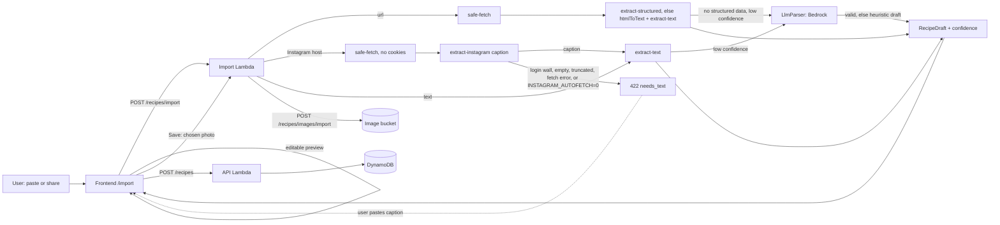

# Nabbit

Purpose: a recipe and shopping-list app (AnyList-style) with individual accounts. Import a recipe from a URL or pasted text, store it metric by default, scale servings client-side, and add scaled ingredients to shopping lists. An installable PWA; the Android Web Share Target sends links straight into import.

Tech stack: Angular PWA / Node 24 TypeScript Lambda backend / shared TypeScript library / CDK (C#, .NET 10) infra / .NET Aspire local orchestration / Playwright e2e.

## Where things are

| Path | What | Doc |
|---|---|---|
| `shared/recipe-core` | Pure recipe types, ingredient parsing, metric conversion, scaling, list types (`@nabbit/recipe-core`) | `shared/recipe-core/SYSDOC.md` |
| `backend` | API Lambda (router + route modules), import Lambda, local Express dev server, FullyRested API suite | `backend/SYSDOC.md` |
| `frontend` | Angular PWA | `frontend/SYSDOC.md` |
| `infrastructure` | CDK app: two stacks, one Lambda per handler | `infrastructure/SYSDOC.md` |
| `e2e` | Playwright browser suite with its own local stack | `e2e/SYSDOC.md` |
| `aspire/Nabbit.AppHost` + `start-aspire.ps1` | `npm run dev` orchestration (launcher script sets env and ports): LocalStack, Cognito Local, MailHog, init-db, backend, frontend | `README.md` |
| `config.example.json` | Deployment config shape (the real one lives in the private Home repo) | `README.md` |

npm workspaces: `shared/*`, `backend`, `frontend`, `e2e`. `infrastructure` is .NET, not a workspace.

## Data flow: import, preview, save

Instagram URLs (`instagram.com`, `www.instagram.com`, `m.instagram.com`, `instagr.am`, https; a trailing dot is ignored) are fetched anonymously through the same guarded fetch (no cookies, honest User-Agent). The caption is extracted from the page (`extract-instagram.ts`) and goes through the normal text path, including the LLM fallback. On a login wall, an empty or truncated caption, any fetch error, or `INSTAGRAM_AUTOFETCH=0`, the import route answers 422 `needs_text` and the frontend asks the user to paste the caption, which is then imported as text. A recipe that lives in a comment is pasted (the "Recipe in a comment?" appender, merged into the existing preview). Comments cannot be fetched anonymously, so they are always pasted. See Key decisions and Known gaps.

Import saves nothing. The draft comes back with ingredients already parsed and metric-converted (`recipe-core`), plus ranked photo `candidates` for URL imports; the client previews and edits, then saves with `POST /recipes`. If a candidate photo is still chosen at Save, the client first calls `POST /recipes/images/import`, which downloads it through the SSRF guard into the image bucket and returns an `imageKey` for the recipe (on failure the recipe saves without a photo). Scaling in the recipe view is purely client-side and non-destructive; "Save as new size" does a `PUT` with the scaled ingredients.

## Single-table key layout

One DynamoDB table, keys `pk`/`sk`, TTL attribute `ttl`. Every item is scoped to its owner by `pk`.

| Item | pk | sk |
|---|---|---|
| Recipe | `OWNER#{ownerId}` | `RECIPE#{id}` |
| Shopping list (items embedded) | `OWNER#{ownerId}` | `LIST#{id}` |
| Item memory (name to category, use count) | `OWNER#{ownerId}` | `MEM#{lowercased name}` |
| Import rate counter | `OWNER#{ownerId}` | `RATE#import#{epoch hour}` |
| LLM daily counter | `OWNER#{ownerId}` | `RATE#llm#{yyyy-mm-dd}` (UTC, 2-day TTL) |
| LLM app-wide daily counter | `GLOBAL` | `RATE#llm#{yyyy-mm-dd}` (UTC, 2-day TTL) |

Key builders and the `Db` interface are in `backend/src/db.ts`.

## Key decisions

- **Deterministic first, LLM as a fallback only.** Import uses structured data (schema.org JSON-LD/microdata) plus deterministic text heuristics; conversion never blocks an import (unknown units pass through). Only when a text draft has fewer than 2 ingredients or fewer than 2 steps is an LLM (AWS Bedrock Converse, small Claude model, id from `LLM_MODEL_ID`, off when unset) asked to parse the text. Structured-data imports and good heuristic drafts never call it. The model has no tools, its input is treated as untrusted data, and its JSON output is schema-validated and re-run through `recipe-core` parsing and metric conversion. Any failure, timeout, invalid output or a result with fewer ingredients or fewer steps than the heuristic keeps the heuristic draft, so the LLM never fails an import. The result is flagged `confidence: 'ai'` and the user always reviews an editable preview. Caps: the 30/hour import limit, 30 LLM calls per owner per UTC day, and an app-wide cap of LLM calls per UTC day across all owners (`LLM_GLOBAL_DAILY_LIMIT`, default 300), so open sign-up cannot multiply the Bedrock spend. Details: `backend/SYSDOC.md`.
- **Instagram's official APIs are not used.** The Basic Display API stopped answering on 2024-12-04; oEmbed needs a Meta app token plus App Review and is not known to return the caption; the Graph API targets business/creator accounts. No logged-in scraping, cookies or crawler impersonation. Instead, Instagram post URLs get an anonymous auto-fetch of the caption, with paste as the fallback. It was gated by a spike (`backend/scripts/spike-instagram.mjs`) that returned GO: run from AWS CloudShell on 2026-11-07, 3 of 3 URLs usable (HTTP 200, `og:description` present, no login redirect, captions of 736, 771 and 1015 characters, none truncated). That is a small sample, Instagram's markup and blocking may change, and Lambda is unproven until Dean's smoke test. Kill switch: the env var `INSTAGRAM_AUTOFETCH=0` makes every Instagram URL return `needs_text`; it is read per request, and unset or any other value means on. The CDK stack does not set it, so flipping it on the deployed import Lambda needs a config/deploy change.
- **Online only.** No offline data; the service worker caches the app shell and assets, never API responses.
- **`ownerId` comes only from the JWT `sub`** (authorizer claim), never from a body or path. Another owner's record is always 404, not 403.
- **SSRF guard** on URL import: https only, DNS resolved and every address checked, connection pinned to the validated IP, redirects re-validated, size and time capped (`backend/SYSDOC.md`).
- **Optimistic concurrency** on recipes and lists: writes carry `version`; stale writes get 409 and the UI offers a reload.
- **Soft delete** for recipes (30-day TTL, restorable); list and list-item deletes are hard (the UI offers Undo by re-creating).
- **Image path**: an image reaches the bucket one of two ways. Uploads: the client asks `POST /recipes/images` for a presigned S3 POST (5 MB cap, exact content type) and uploads directly. Imports: the import Lambda fetches the chosen candidate server-side (`POST /recipes/images/import`, same 5 MB cap, jpeg/png/webp only). Either way the client stores the returned `imageKey` (`{ownerId}/{uuid}.{ext}`). Images are read through CloudFront at `/img/{imageKey}`; the bucket is private. Image URLs are public capability URLs (see Known gaps and decisions).
- **Abuse guards**: a per-user import rate limit, a per-user daily LLM cap, an app-wide daily LLM cap, plus a dedicated import Lambda with reserved concurrency.
- **Deploy** is manual and lives in the private Home repo; this repo's CI only builds and tests.

## Known gaps and decisions

Code and tests exist, but these have not been verified end to end:

- `npm run dev` (the Aspire stack) was run for real on alternate ports (2026-11-02): containers, `init-db`, backend `/health`, an `X-Dev-Sub` POST/GET round trip and the frontend dev server all worked. Not verified: the Cognito Local sign-in flow, running on the default ports, and a clean Ctrl+C shutdown (the verification run was killed, which orphaned its containers).
- The deploy script and the manual deploy workflow in Home (which now update both the API and import Lambdas) have never been run.
- Unverified on real infrastructure: the Cognito sign-in and Hosted UI sign-out round trip (the frontend does a real logout and lands on a "signed out" screen), the install prompt, the Android share sheet, S3 presigned upload against the bucket CORS rule, and API Gateway answering CORS preflight itself (the API has no authorized `$default` route).
- `pinnedFetch` (the real TLS path of `safe-fetch`) has no automated test; the e2e fixture hook bypasses it.
- `POST /recipes/images/import` and the photo candidate chooser are unverified on real infrastructure until Dean's smoke test (the import Lambda's S3 write and its new API Gateway route have never been exercised in AWS).
- The Bedrock LLM path (model access, the scoped `bedrock:InvokeModel` grant, `LLM_MODEL_ID`, real model output) is unverified on real infrastructure until Dean's smoke test; unit and e2e tests use a stub parser. Bedrock model access must be enabled in the account first.
- Instagram auto-fetch is unverified on Lambda until Dean's smoke test: the spike (3 URLs, from CloudShell) is a small sample and the Lambda's egress IPs may be treated differently. If Instagram blocks it, imports degrade to `needs_text` (paste), not to an error.
- The import rate limit is a fixed clock-hour bucket, so a burst of up to 60 is possible across an hour boundary.
- `GET /health` exists only on the local server; the CDK stack has no health route.
- A 401 body differs: `{error:'unauthorized'}` locally, `{"message":"Unauthorized"}` from the API Gateway authorizer.
- `formatQuantity` (display text) omits an ingredient's `note`.
- Tiny scaled weights round to `0 g` in `recipe-core` metric rounding (e.g. 1 g scaled by 0.25).

Deferred decisions, accepted for the MVP (detail in `infrastructure/SYSDOC.md`):

- Recipe images are public capability URLs (`/img/{sub}/{uuid}.ext` via CloudFront): unguessable UUID, but the key exposes the Cognito `sub`. Alternatives: signed URLs/cookies or an opaque owner hash in the key.
- CloudFront's distribution-wide 403/404 to `/index.html` 200 rule also covers `/img/*`, so a missing image returns HTML with status 200. Fix idea: SPA fallback on the default behaviour only.
