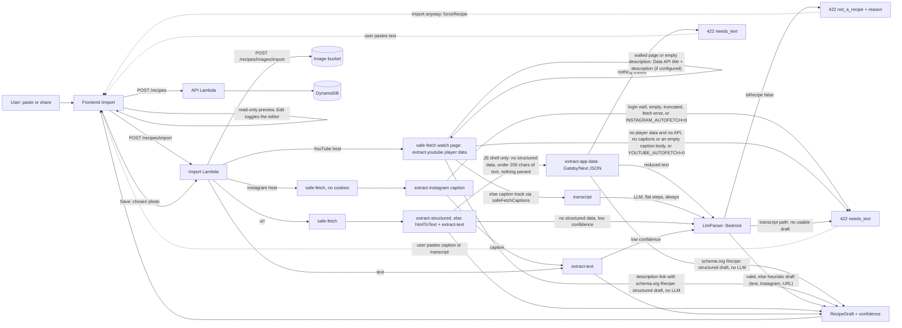

# Nabbit

Purpose: a recipe and shopping-list app (AnyList-style) with individual accounts. Import a recipe from a URL or pasted text, store it metric by default, scale servings client-side, and add scaled ingredients to shopping lists. An installable PWA; the Android Web Share Target sends links straight into import.

Tech stack: Angular PWA / Node 24 TypeScript Lambda backend / shared TypeScript library / CDK (C#, .NET 10) infra / .NET Aspire local orchestration / Playwright e2e.

## Where things are

| Path | What | Doc |
|---|---|---|
| `shared/recipe-core` | Pure recipe types, ingredient parsing, metric conversion, scaling, list types (`@nabbit/recipe-core`) | `shared/recipe-core/SYSDOC.md` |
| `backend` | API Lambda (router + route modules), import Lambda, local Express dev server, FullyRested API suite | `backend/SYSDOC.md` |
| `frontend` | Angular PWA | `frontend/SYSDOC.md` |
| `infrastructure` | CDK app: two stacks, one Lambda per handler | `infrastructure/SYSDOC.md` |
| `e2e` | Playwright browser suite with its own local stack | `e2e/SYSDOC.md` |
| `aspire/Nabbit.AppHost` + `start-aspire.ps1` | `npm run dev` orchestration (launcher script sets env and ports): LocalStack, Cognito Local, MailHog, init-db, backend, frontend | `README.md` |
| `config.example.json` | Deployment config shape (the real one lives in the private Home repo) | `README.md` |

npm workspaces: `shared/*`, `backend`, `frontend`, `e2e`. `infrastructure` is .NET, not a workspace.

## Public landing and in-app help

- **Routes** (`frontend/src/app/app.routes.ts`): `/` is a public landing page behind `landingGuard` (signed-in users are redirected to `/recipes`, visitors see the landing). `/help` and `/help/:topic` render the help guides behind `authGuard`, and the avatar menu has a Help entry.
- **Help pipeline**: the guides are markdown in `docs/help/` (numbered `NN-slug.md`, first heading is the title; `docs/help/README.md` is not a topic) with screenshots in `docs/help/images/`. `frontend/scripts/help-index.mjs` runs as `prebuild`, `prebuild:dev`, `prestart` and `pretest`: it mirrors `docs/help` into the git-ignored `frontend/src/assets/help/` and writes `help-index.json` (ordered slug/title list). The `src/assets` glob in `angular.json` serves them at `/assets/help`, and the help viewer renders them with `marked`. Edit `docs/help`, never the mirror.
- **Screenshots**: `npm run help:screenshots` (`e2e/screenshots/capture.mjs`, Playwright) needs the e2e stack running first (`npm run stack:up -w e2e`). It writes desktop and phone shots to `docs/help/images/` and the landing page images to `frontend/src/assets/screens/`. `src/assets` is git-ignored, so the landing images are force-added (`git add -f`); re-run and re-add after UI changes.

## Data flow: import, preview, save

Instagram URLs (`instagram.com`, `www.instagram.com`, `m.instagram.com`, `instagr.am`, https; a trailing dot is ignored) are fetched anonymously through the same guarded fetch (no cookies, honest User-Agent). The caption is extracted from the page (`extract-instagram.ts`) and goes through the normal text path, including the LLM fallback. On a login wall, an empty or truncated caption, any fetch error, or `INSTAGRAM_AUTOFETCH=0`, the import route answers 422 `needs_text` and the frontend asks the user to paste the caption, which is then imported as text. A recipe that lives in a comment is pasted (the "Recipe in a comment?" appender, merged into the existing preview; it always sends `forceRecipe: true`, since the user has said the comment is the recipe). Comments cannot be fetched anonymously, so they are always pasted. For the same reason an Instagram caption never ends in the not-a-recipe panel ("recipe in the comments" posts): an auto-fetched caption the LLM calls not-a-recipe gets the heuristic draft back from the server with the post's photo candidates, and a pasted caption is sent by the client with `forceRecipe: true`; the appender then recovers the recipe. A non-Instagram page with no structured data, under 200 characters of visible text and no ingredients or steps (a JavaScript-built shell) is not sent to the LLM as is: the server first tries the app data embedded in the page (`extract-app-data.ts`: Gatsby `/page-data/<path>/page-data.json` on the same origin, or Next `__NEXT_DATA__`) and uses it: a schema.org Recipe inside the data becomes a structured draft with no LLM, otherwise a reduced text goes to the LLM (so only that reduced-text path needs an LLM configured). The app-data step runs only for such shells; pages with real text (including server-rendered Next pages) keep the normal heuristic/LLM path, and a request makes at most one LLM attempt. The page-data fetch is pinned to the page's origin (a redirect to another origin is refused before it is fetched). If nothing usable results, or the reduced-text path has no LLM, it answers 422 `needs_text` and the frontend shows a generic paste prompt. Tracking params are stripped from `sourceUrl`. See Key decisions and Known gaps.

YouTube URLs (`youtube.com`, `www.youtube.com`, `m.youtube.com`, `youtu.be`, https; watch, `youtu.be`, `/shorts/`, `/live/` and `/embed/` forms, sent and saved as the canonical `https://www.youtube.com/watch?v=<id>` so share params like `si=` never reach `sourceUrl`) have their own branch in the import route. The watch page is fetched anonymously through the guarded fetch and its embedded player data (title, description, caption tracks) is read (`extract-youtube.ts`). Order of attempts: (1) up to 3 links from the description (a skip list drops YouTube/Google, social, shops, shorteners and tip jars) are tried as pages, and the first with a schema.org Recipe becomes the draft with no LLM (`youtube-links.ts`, `structured-page.ts`); (2) otherwise the best caption track (manual English, auto English, first) is fetched through `safeFetchCaptions` and the transcript plus title and description go to the LLM in one call that asks for flat steps (group headings are dropped); (3) anything else is 422 `needs_text` and the frontend asks for a pasted transcript. The response carries `source` (`linked-page` or `transcript`) and `videoUrl`; `sourceUrl` is the recipe page for a linked import and the video URL for a transcript import. `ignoreLinkedRecipe` skips step 1 (the "Use the video transcript instead" button). The draft has no notes field, so the video link exists only as `videoUrl`; transcript imports carry no photos. A fixed time budget keeps the worst case inside the 29 s API Gateway/Lambda limit (`backend/SYSDOC.md`).

Not-a-recipe guardrail: the LLM is first asked whether the text is a recipe. `isRecipe: false` becomes the `NotRecipe` outcome and the import route answers 422 `not_a_recipe` with the model's short `reason` (no draft; scheme URLs, `www.` links and control characters are stripped from `reason`, bare domains are not; a reason left empty counts as invalid output, so the heuristic draft is kept). Instagram captions never get this 422 (see above). The frontend offers "Import anyway" (resends with `forceRecipe: true`) or "Paste text instead". `forceRecipe` makes the LLM call a best-effort one with no not-a-recipe exit, on every path. If that still yields nothing usable, the text, Instagram and URL paths return the heuristic draft, while the YouTube transcript path and a JS-shell page answer `needs_text`. It is the same single LLM call, so it counts once against the per-owner (30/day) and global caps.

Import saves nothing. The import page opens a read-only preview of the draft (`RecipeView`) with an action bar (Save, Edit, Discard) above and below it; Edit swaps in the editor and Back to preview returns. The draft comes back with ingredients already parsed and metric-converted (`recipe-core`); the preview shows amounts and temperatures as written in the source (`RecipeView` `original` mode), so the "check the quantities" banners check what was read, while the saved recipe opens metric. The draft also carries ranked photo `candidates` for URL imports; the client saves with `POST /recipes`. If a candidate photo is still chosen at Save, the client first calls `POST /recipes/images/import`, which downloads it through the SSRF guard into the image bucket and returns an `imageKey` for the recipe (on failure the recipe saves without a photo). Scaling in the recipe view is purely client-side and non-destructive: one scale factor, set either by servings or by an anchor ingredient (`Recipe.scaleBy` is the default anchor, converted within the same unit family only). "Save as new size" does a `PUT` with the scaled ingredients and, the first time, stores the pre-save size as `originalSize`, a first-size backup that is never overwritten; "Restore original size" (with a lost-changes warning) PUTs it back and omits `originalSize`, which clears it.

## Single-table key layout

One DynamoDB table, keys `pk`/`sk`, TTL attribute `ttl`. Every item is scoped to its owner by `pk`.

| Item | pk | sk |
|---|---|---|
| Recipe | `OWNER#{ownerId}` | `RECIPE#{id}` |
| Shopping list (items embedded) | `OWNER#{ownerId}` | `LIST#{id}` |
| Item memory (name to category, use count) | `OWNER#{ownerId}` | `MEM#{lowercased name}` |
| Import rate counter | `OWNER#{ownerId}` | `RATE#import#{epoch hour}` |
| LLM daily counter | `OWNER#{ownerId}` | `RATE#llm#{yyyy-mm-dd}` (UTC, 2-day TTL) |
| LLM app-wide daily counter | `GLOBAL` | `RATE#llm#{yyyy-mm-dd}` (UTC, 2-day TTL) |

Key builders and the `Db` interface are in `backend/src/db.ts`.

## Key decisions

- **Deterministic first, LLM as a fallback only.** Import uses structured data (schema.org JSON-LD/microdata) plus deterministic text heuristics; conversion never blocks an import (unknown units pass through). Only when a text draft has fewer than 2 ingredients or fewer than 2 steps is an LLM (AWS Bedrock Converse, small Claude model, id from `LLM_MODEL_ID`, off when unset) asked to parse the text. Structured-data imports and good heuristic drafts never call it. The model has no tools, its input is treated as untrusted data, and its JSON output is schema-validated and re-run through `recipe-core` parsing and metric conversion. Any failure, timeout, invalid output or a result with fewer ingredients or fewer steps than the heuristic keeps the heuristic draft, so the LLM never fails an import. The result is flagged `confidence: 'ai'` and the user always reviews an editable preview. Caps: the 30/hour import limit, 30 LLM calls per owner per UTC day, and an app-wide cap of LLM calls per UTC day across all owners (`LLM_GLOBAL_DAILY_LIMIT`, default 300), so open sign-up cannot multiply the Bedrock spend. Details: `backend/SYSDOC.md`.
- **Not-a-recipe guardrail.** The LLM may answer that the text is not a recipe; the route then returns 422 `not_a_recipe` + `reason` instead of a junk draft, and the user can override with `forceRecipe` ("Import anyway"). It rides on the existing single LLM call (no extra call or cost), so it only exists where the LLM runs: text drafts with fewer than 2 ingredients or steps, and the YouTube transcript. A structured or good heuristic draft is never second-guessed, and an Instagram caption never gets the 422 (an auto-fetched one keeps its heuristic draft on the server, a pasted one is sent with `forceRecipe`; the "recipe in the comments" case is handled by the comment appender).
- **YouTube is auto-fetched anonymously, linked recipe first.** A recipe page linked from the description is preferred because it is structured and needs no LLM; the transcript is the fallback and is always parsed by the LLM with flat steps (spoken prose has no heuristic parse, and the model would invent group headings). When the anonymous watch page is walled (AWS egress IPs often get a bot or consent wall) or has no description, the YouTube Data API v3 supplies title + description instead (key in an SSM SecureString named by `YOUTUBE_API_KEY_PARAM`, optional; off when unset). An empty caption body (YouTube returns HTTP 200 with nothing to anonymous clients) counts as "no captions", so a description alone never goes to the LLM. Each stage logs one JSON line (`evt: "yt"`, no description text, no key). The expected failure mode is `needs_text` (paste the transcript), never an error. Kill switch: `YOUTUBE_AUTOFETCH=0` makes every YouTube URL return `needs_text`; it is read per request, and the CDK stack does not set it, so flipping it on the deployed import Lambda needs a config/deploy change. Feasibility is meant to be gated by `backend/scripts/spike-youtube.mjs` (owner runs it from CloudShell); the code shipped before that run (see Known gaps).
- **Instagram's official APIs are not used.** The Basic Display API stopped answering on 2024-12-04; oEmbed needs a Meta app token plus App Review and is not known to return the caption; the Graph API targets business/creator accounts. No logged-in scraping, cookies or crawler impersonation. Instead, Instagram post URLs get an anonymous auto-fetch of the caption, with paste as the fallback. It was gated by a spike (`backend/scripts/spike-instagram.mjs`) that returned GO: run from AWS CloudShell on 2026-11-07, 3 of 3 URLs usable (HTTP 200, `og:description` present, no login redirect, captions of 736, 771 and 1015 characters, none truncated). That is a small sample, Instagram's markup and blocking may change, and Lambda is unproven until Dean's smoke test. Kill switch: the env var `INSTAGRAM_AUTOFETCH=0` makes every Instagram URL return `needs_text`; it is read per request, and unset or any other value means on. The CDK stack does not set it, so flipping it on the deployed import Lambda needs a config/deploy change.
- **Steps are a tree, not a flat list.** `Recipe.steps` is `StepNode[]`, each a string or a group `{heading?, steps}` (`recipe-core`; depth cap 5 with a flat list as depth 1, 100 leaves), and a flat list stays valid. Structured imports (JSON-LD `HowToSection`/`itemListElement`, microdata) keep sections as groups, splicing any deeper than the cap into the parent. Gatsby/Next app-data, the LLM and pasted-text paths stay flat. The recipe view renders groups recursively, the editor edits the tree, and the import-preview merge dedupes at every depth. Details: `backend/SYSDOC.md`, `frontend/SYSDOC.md`, `shared/recipe-core/SYSDOC.md`.
- **Online only.** No offline data; the service worker caches the app shell and assets, never API responses.
- **`ownerId` comes only from the JWT `sub`** (authorizer claim), never from a body or path. Another owner's record is always 404, not 403.
- **SSRF guard** on URL import: https only, DNS resolved and every address checked, connection pinned to the validated IP, redirects re-validated, size and time capped (`backend/SYSDOC.md`).
- **Optimistic concurrency** on recipes and lists: writes carry `version`; stale writes get 409 and the UI offers a reload.
- **Soft delete** for recipes (30-day TTL, restorable); list and list-item deletes are hard (the UI offers Undo by re-creating).
- **Image path**: an image reaches the bucket one of two ways. Uploads: the client asks `POST /recipes/images` for a presigned S3 POST (5 MB cap, exact content type) and uploads directly. Imports: the import Lambda fetches the chosen candidate server-side (`POST /recipes/images/import`, same 5 MB cap, jpeg/png/webp only). Either way the client stores the returned `imageKey` (`{ownerId}/{uuid}.{ext}`). Images are read through CloudFront at `/img/{imageKey}`; the bucket is private. Image URLs are public capability URLs (see Known gaps and decisions).
- **Abuse guards**: a per-user import rate limit, a per-user daily LLM cap, an app-wide daily LLM cap, plus a dedicated import Lambda with reserved concurrency.
- **Deploy** is manual and lives in the private Home repo; this repo's CI only builds and tests.

## Known gaps and decisions

Code and tests exist, but these have not been verified end to end:

- `npm run dev` (the Aspire stack) was run for real on alternate ports (2026-11-02): containers, `init-db`, backend `/health`, an `X-Dev-Sub` POST/GET round trip and the frontend dev server all worked. Not verified: the Cognito Local sign-in flow, running on the default ports, and a clean Ctrl+C shutdown (the verification run was killed, which orphaned its containers).
- The deploy script and the manual deploy workflow in Home (which now update both the API and import Lambdas) have never been run.
- Unverified on real infrastructure: the Cognito sign-in and Hosted UI sign-out round trip (the frontend does a real logout and lands on a "signed out" screen), the install prompt, the Android share sheet, S3 presigned upload against the bucket CORS rule, and API Gateway answering CORS preflight itself (the API has no authorized `$default` route).
- `pinnedFetch` (the real TLS path of `safe-fetch`) has no automated test; the e2e fixture hook bypasses it.
- `POST /recipes/images/import` and the photo candidate chooser are unverified on real infrastructure until Dean's smoke test (the import Lambda's S3 write and its new API Gateway route have never been exercised in AWS).
- The Bedrock LLM path (model access, the scoped `bedrock:InvokeModel` grant, `LLM_MODEL_ID`, real model output) is unverified on real infrastructure until Dean's smoke test; unit and e2e tests use a stub parser. Bedrock model access must be enabled in the account first.
- Instagram auto-fetch is unverified on Lambda until Dean's smoke test: the spike (3 URLs, from CloudShell) is a small sample and the Lambda's egress IPs may be treated differently. If Instagram blocks it, imports degrade to `needs_text` (paste), not to an error.
- YouTube auto-fetch is unverified against real YouTube and on Lambda. The spike (`backend/scripts/spike-youtube.mjs`; verdicts GO, NO-GO or INCONCLUSIVE) has not been run (owner task); its default list is a single URL, which can only give INCONCLUSIVE, so a real verdict needs 3 or more URLs, a small sample at best. YouTube may block datacenter IPs, show a consent wall or change its player-data layout; the degraded outcome is `needs_text`. The time budget (about 24 s worst case of 29 s) has not been measured on a cold Lambda.
- The not-a-recipe verdict is only tested with a stub parser (unit tests, e2e fake-LLM markers). Real Bedrock behaviour (false positives on terse recipes, the wording of `reason`, the forced best-effort prompt) is unverified until Dean's smoke test.
- The import rate limit is a fixed clock-hour bucket, so a burst of up to 60 is possible across an hour boundary.
- `GET /health` exists only on the local server; the CDK stack has no health route.
- A 401 body differs: `{error:'unauthorized'}` locally, `{"message":"Unauthorized"}` from the API Gateway authorizer.
- `formatQuantity` (display text) omits an ingredient's `note`.
- Scaling by an ingredient converts only within a unit family: no volume to weight conversion (no density table), and a unit with no family is matched only against itself.
- Tiny scaled weights round to `0 g` in `recipe-core` metric rounding (e.g. 1 g scaled by 0.25).

Deferred decisions, accepted for the MVP (detail in `infrastructure/SYSDOC.md`):

- Recipe images are public capability URLs (`/img/{sub}/{uuid}.ext` via CloudFront): unguessable UUID, but the key exposes the Cognito `sub`. Alternatives: signed URLs/cookies or an opaque owner hash in the key.
- CloudFront's distribution-wide 403/404 to `/index.html` 200 rule also covers `/img/*`, so a missing image returns HTML with status 200. Fix idea: SPA fallback on the default behaviour only.
