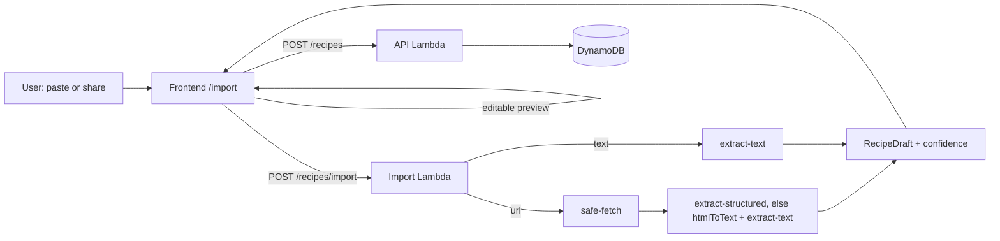

# Nabbit

Purpose: a recipe and shopping-list app (AnyList-style) with individual accounts. Import a recipe from a URL or pasted text, store it metric by default, scale servings client-side, and add scaled ingredients to shopping lists. An installable PWA; the Android Web Share Target sends links straight into import.

Tech stack: Angular PWA / Node 24 TypeScript Lambda backend / shared TypeScript library / CDK (C#, .NET 10) infra / .NET Aspire local orchestration / Playwright e2e.

## Where things are

| Path | What | Doc |
|---|---|---|
| `shared/recipe-core` | Pure recipe types, ingredient parsing, metric conversion, scaling, list types (`@nabbit/recipe-core`) | `shared/recipe-core/SYSDOC.md` |
| `backend` | API Lambda (router + route modules), import Lambda, local Express dev server, FullyRested API suite | `backend/SYSDOC.md` |
| `frontend` | Angular PWA | `frontend/SYSDOC.md` |
| `infrastructure` | CDK app: two stacks, one Lambda per handler | `infrastructure/SYSDOC.md` |
| `e2e` | Playwright browser suite with its own local stack | `e2e/SYSDOC.md` |
| `aspire/Nabbit.AppHost` | `npm run dev` orchestration: LocalStack, Cognito Local, MailHog, init-db, backend, frontend | `README.md` |
| `config.example.json` | Deployment config shape (the real one lives in the private Home repo) | `README.md` |

npm workspaces: `shared/*`, `backend`, `frontend`, `e2e`. `infrastructure` is .NET, not a workspace.

## Data flow: import, preview, save

Import saves nothing. The draft comes back with ingredients already parsed and metric-converted (`recipe-core`); the client previews and edits, then saves with `POST /recipes`. Scaling in the recipe view is purely client-side and non-destructive; "Save as new size" does a `PUT` with the scaled ingredients.

## Single-table key layout

One DynamoDB table, keys `pk`/`sk`, TTL attribute `ttl`. Every item is scoped to its owner by `pk`.

| Item | pk | sk |
|---|---|---|
| Recipe | `OWNER#{ownerId}` | `RECIPE#{id}` |
| Shopping list (items embedded) | `OWNER#{ownerId}` | `LIST#{id}` |
| Item memory (name to category, use count) | `OWNER#{ownerId}` | `MEM#{lowercased name}` |
| Import rate counter | `OWNER#{ownerId}` | `RATE#import#{epoch hour}` |

Key builders and the `Db` interface are in `backend/src/db.ts`.

## Key decisions

- **No LLM.** Import uses structured data (schema.org JSON-LD/microdata) plus deterministic text heuristics; conversion never blocks an import (unknown units pass through).
- **Online only.** No offline data; the service worker caches the app shell and assets, never API responses.
- **`ownerId` comes only from the JWT `sub`** (authorizer claim), never from a body or path. Another owner's record is always 404, not 403.
- **SSRF guard** on URL import: https only, DNS resolved and every address checked, connection pinned to the validated IP, redirects re-validated, size and time capped (`backend/SYSDOC.md`).
- **Optimistic concurrency** on recipes and lists: writes carry `version`; stale writes get 409 and the UI offers a reload.
- **Soft delete** for recipes (30-day TTL, restorable); list and list-item deletes are hard (the UI offers Undo by re-creating).
- **Image path**: the client asks `POST /recipes/images` for a presigned S3 POST (5 MB cap, exact content type), uploads directly, and stores the returned `imageKey` (`{ownerId}/{uuid}.{ext}`). Images are read through CloudFront at `/img/{imageKey}`; the bucket is private.
- **Abuse guards**: a per-user import rate limit plus a dedicated import Lambda with reserved concurrency.
- **Deploy** is manual and lives in the private Home repo; this repo's CI only builds and tests.

## Known gaps

Code and tests exist, but these have not been verified end to end:

- `npm run dev` (Aspire + Docker stack) has never been started end to end; the parts are covered by the API suite and the e2e stack.
- The deploy script and the manual deploy workflow in Home have never been run.
- Real Cognito sign-in, the install prompt, the Android share sheet, and S3 presigned upload with its CORS rule are untested on real infrastructure.
- The import rate limit is a fixed clock-hour bucket, so a burst of up to 60 is possible across an hour boundary.
- `GET /health` exists only on the local server; the CDK stack has no health route.
- `formatQuantity` (display text) omits an ingredient's `note`.
