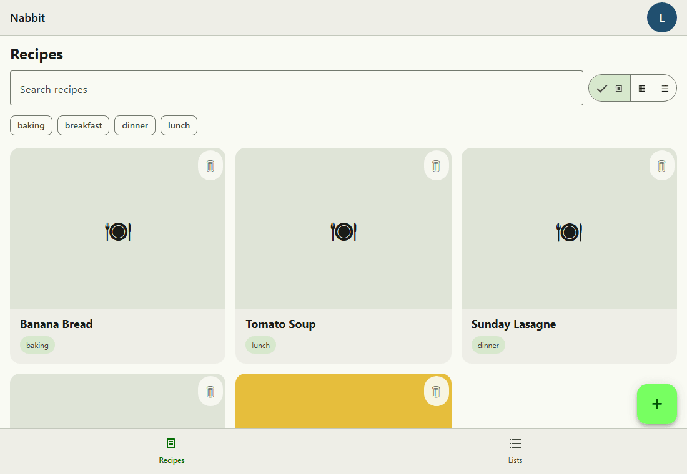
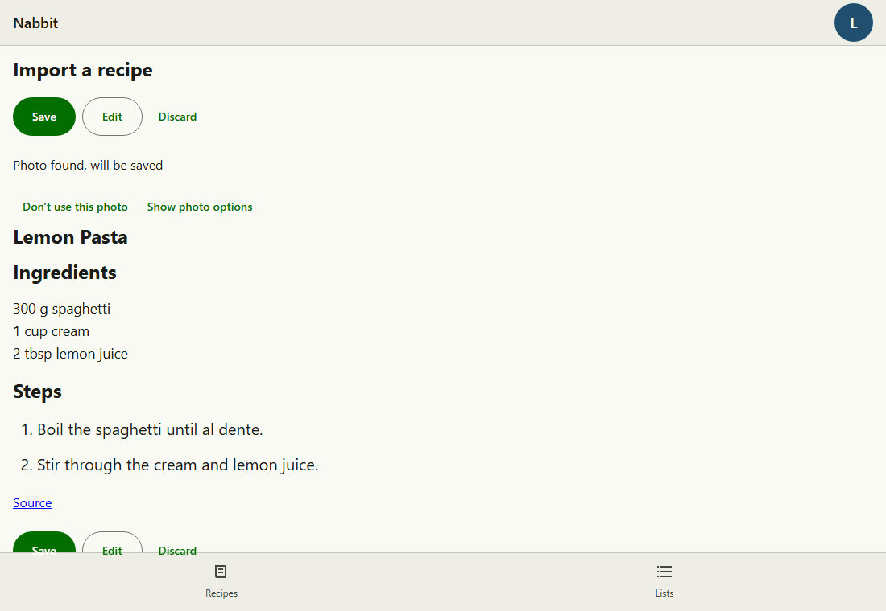

# Getting started

Nabbit keeps your recipes and shopping lists in one place. Bring a recipe in from a web page, a pasted block of text, an Instagram post or a YouTube video, scale it to the size you need, and add its ingredients to a shopping list.

## Sign in

Open Nabbit and choose **Sign in / Get started**. You sign in (or create an account) on the secure sign-in page, then land on your recipes. Your recipes and lists belong to your account only.

## The two main places

The bottom bar has two tabs:

- **Recipes** is your collection. Search by title, filter with tag chips, and switch between large, small and list views. The round button adds a recipe.
- **Lists** holds your shopping lists.

The round avatar at the top right opens a menu with your name, **Help** and **Sign out**.

## Your first recipe

1. Tap the add button on **Recipes** to open the import screen.
2. Paste a link or the recipe text. See [Importing a recipe](03-importing-a-recipe.md).
3. Check the preview, fix anything that looks wrong with **Edit**, then **Save**.

Recipes are stored in metric (grams, millilitres, degrees Celsius). While previewing you still see the amounts as they were written in the source.

## Next steps

- [Install Nabbit as an app](02-installing-the-app.md) on your phone or computer.
- [Scale a recipe](04-scaling-recipes.md) up or down.
- [Build a shopping list](05-shopping-lists.md) from a recipe.
- Stuck? See [Troubleshooting](06-troubleshooting.md).

Nabbit needs an internet connection. Your recipes and lists are always fetched live.
