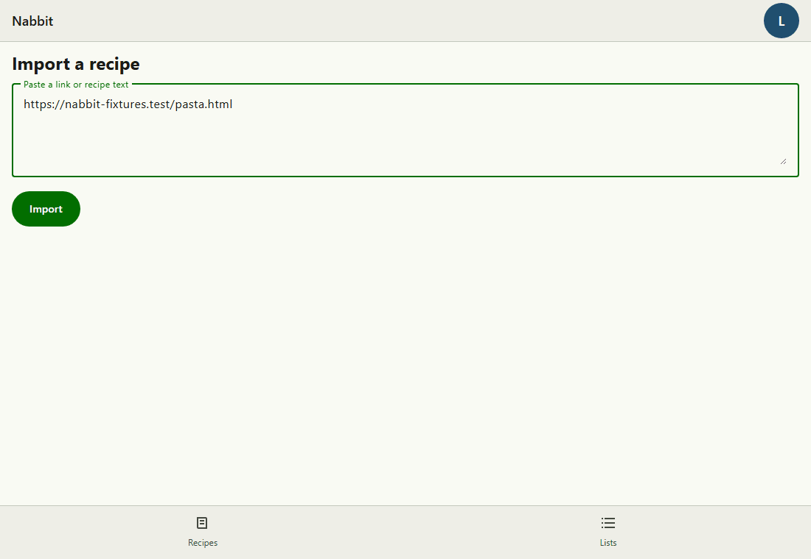
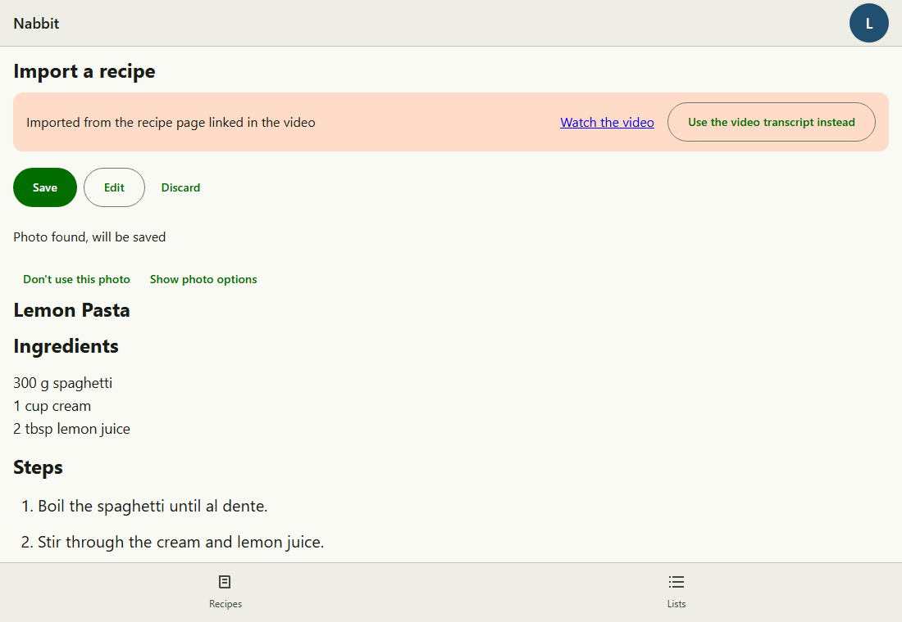

# Importing a recipe

Importing never saves anything by itself. Nabbit reads the source and shows a preview, and you decide whether to **Save**, **Edit** or **Discard**.

## From a web page

Paste the page address into the import box. Nabbit reads the recipe the site publishes, including ingredients, steps and a photo. Pages that publish their recipe in the standard way import precisely.

## From pasted text

Paste the recipe text instead of a link: from an email, a note, a book you typed up. Nabbit picks out the title, ingredients and steps. If the text is untidy, an AI helper may be used to read it, and the preview then shows an **AI-assisted - check the ingredients** banner. Always glance over the amounts.

If the text does not look like a recipe, Nabbit says so and gives a short reason. Choose **Import anyway** if you know it is one, or **Paste text instead**.

## From Instagram

Paste a post or reel link. Nabbit tries to read the caption anonymously. If Instagram will not show it (a login wall, an empty caption), Nabbit asks you to paste the caption yourself: copy it from the post and paste it into the box.

Recipes are often in the comments rather than the caption. After the preview appears, use **Recipe in a comment? Paste it here to add it**. The comment is merged into the preview, skipping anything already there.

## From YouTube

Paste a video link. Nabbit looks first for a recipe page linked in the description, which gives the cleanest result. If there is none, it reads the video's captions and works out the recipe from them (always AI-assisted, so check quantities). The preview says which it used, with a **Watch the video** link. If you would rather have the transcript version, choose **Use the video transcript instead**.

If captions cannot be read, Nabbit asks you to paste the transcript.

## From the Android share sheet

With Nabbit [installed on Android](02-installing-the-app.md), share a link or text from Chrome, Instagram, YouTube or any other app and pick **Nabbit**. It opens the import screen and starts importing straight away. If you are signed out, you sign in first and then continue with the import.

## The preview

- The preview shows amounts as written in the source, so you can check what was read. Saved recipes open in metric.
- For web pages, Nabbit finds candidate photos. They are not loaded from the other site until you tap **Show photo options**. You can pick another one, upload your own or remove it. The chosen photo is saved with the recipe.
- **Edit** opens the editor for ingredients, steps, tags and servings; **Back to preview** returns.
- **Discard** leaves without saving, and asks first if you changed something.

## When a site cannot be read

Some sites build their pages with JavaScript or block automated readers. Nabbit then asks you to paste the text instead: open the page, select the recipe, copy, and paste it into the box. Pasting works for every source.

## Limits

To keep the service running for everyone there is a limit of 30 imports per hour per person, and a daily limit on AI-assisted reads. Normal use will not hit them. See [Troubleshooting](06-troubleshooting.md) if you do.
