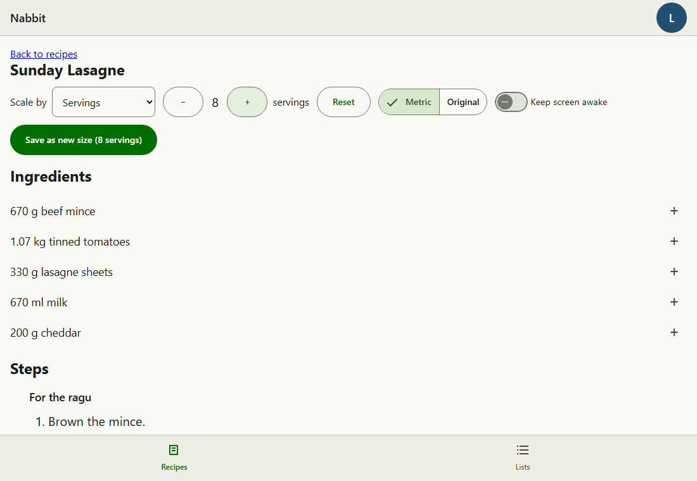
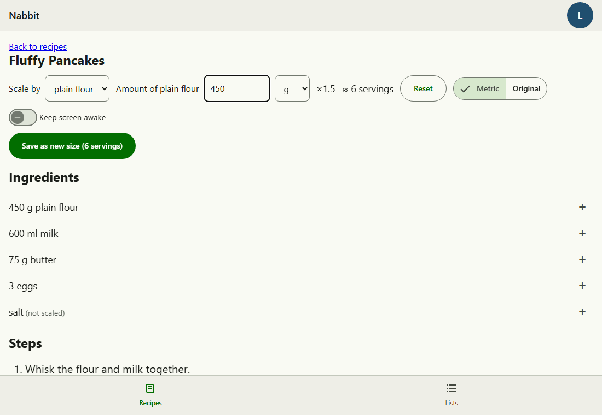

# Scaling recipes

Open a recipe and use **Scale by** to change its size. Scaling is only a view until you choose to save it, so you can experiment freely.

## Metric by default

Nabbit stores recipes in metric: grams, millilitres and degrees Celsius, including temperatures written inside steps. Cups, ounces and Fahrenheit are converted when the recipe is imported. Anything Nabbit does not recognise is left exactly as written rather than guessed at. Open an ingredient to see its original wording.

## Scale by servings

The default is a **Servings** stepper. Change the number and every ingredient scales to match.

## Scale by an ingredient

Sometimes you care about one ingredient, such as having only 300 g of flour. Pick that ingredient in **Scale by**, type the amount you have, and everything else follows. The servings number updates to match, rounded to the nearest half.

Scaling by an ingredient works within one kind of unit (weight to weight, volume to volume). Nabbit does not convert between weight and volume, because that depends on the ingredient. In the recipe editor you can set a **Default scale-by** ingredient so the recipe opens that way.

**Reset** returns to the recipe's saved size.

## Keep the new size

**Save as new size** replaces the stored ingredients with the scaled ones, after a confirmation that lists the changes. The first time you do this, Nabbit keeps the original size as a backup.

To undo, choose **Restore original size**. It shows each ingredient's current and original amount and warns that any edits made since will be lost.

Very small amounts can round to zero in metric (for example a gram scaled down to a quarter), so check the tiniest ingredients after scaling down a lot.

## Scaled ingredients go to your list

**Add to list** uses the scaled amounts. See [Shopping lists](05-shopping-lists.md).
