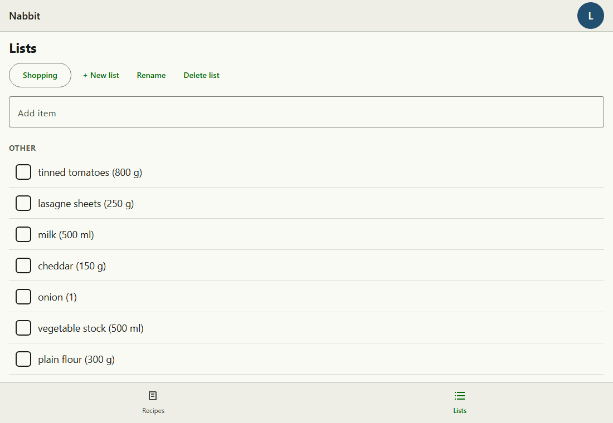
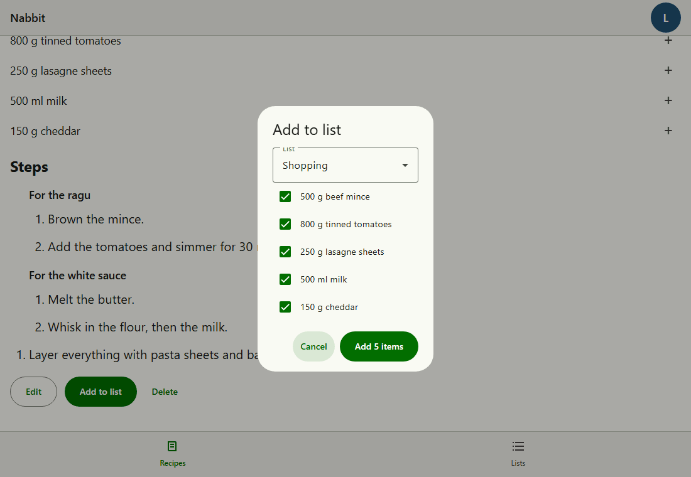

# Shopping lists

The **Lists** tab holds your shopping lists. A list called **Shopping** is created for you; add more for different stores or occasions, and rename or delete them from the list picker.

## Adding items by hand

Type in the box at the top of the list. Suggestions appear as you type, drawn from items you have added before. Nabbit remembers which aisle each item belongs to, so your usual items sort themselves.

## Adding from a recipe

On a recipe, choose **Add to list**. You see the ingredients at the current scale, each with a tick box, and choose the list. Items such as "salt, to taste" start unticked. The list entry is the ingredient with its scaled amount, for example `flour (480 ml)`.

For a single ingredient, use the add button beside it on the recipe. One tap adds it to the list you used last, and an **Undo** button appears briefly.

## Working the list

- Items are grouped under an aisle heading (items without a known aisle sit under Other). Tap an item to tick it off; it moves to the bottom of its group, struck through. Tap again to untick.
- Double-tap an item to delete it. A short **Undo** message lets you bring it back.
- Press and hold an item to change its aisle.

If you edit the same list from two places at once, the second save may be told the list changed. Reload and try again.
